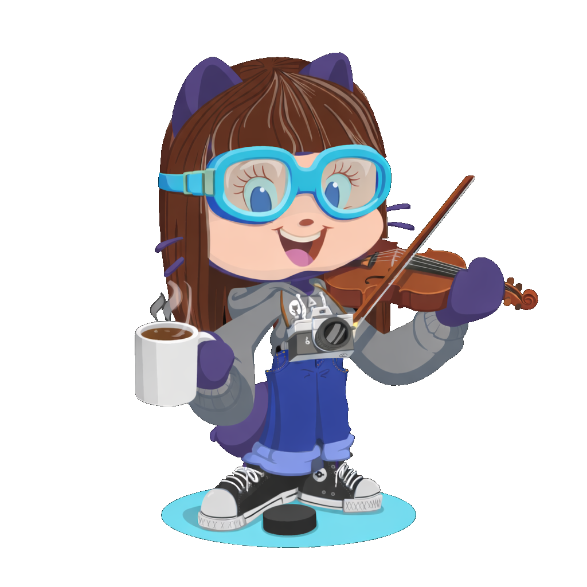

# 👋 Hi, I’m Courtney Robertson

I’m an **Open Source Developer Advocate at GoDaddy**, a longtime **WordPress contributor**, and a former **computer science educator** working at the intersection of community, governance, and sustainable open source.

I help people move from *curious* to *contributing*, and I care deeply about the systems that keep open-source projects healthy over time.

---

## 🧭 What I work on

### 🌍 Open source sustainability & governance
I’m a **co-founding board member of [The WP Open Community Collective](https://www.thewpcommunitycollective.com/)**, a nonprofit that supports open-source contributors through funding programs, shared infrastructure, and transparent governance.  
My focus within The WPOCC includes contributor support models, organizational clarity, and long-term resilience.

I also support and contribute to **[FAIR](https://fair.pm/)**, an initiative working toward **federated, independent, and verifiable software distribution** for WordPress packages.

---

### 🧱 WordPress development & contribution
I’m an active contributor within the **[WordPress GitHub repository](https://github.com/WordPress/wordpress-develop)** and across the broader WordPress ecosystem, with particular attention to contributor experience, training, and sustainable participation.

You can find my public contribution history on **[WordPress.org](https://profiles.wordpress.org/courane01/)**.

---

### 🎓 Education, advocacy, and speaking
Before working in developer advocacy, I spent years as a professional educator. That background shapes how I approach DevRel today: clear language, strong context, and respect for people’s time and cognitive load.

I regularly support:
- Developer education and documentation
- Contributor onboarding and mentorship
- Talks, workshops, and community discussions about open source health

---

## 🛠️ Tools & practices
- **Languages:** PHP, JavaScript, HTML, CSS, SQL  
- **Ecosystems:** WordPress, open source communities, documentation workflows  
- **Focus areas:** sustainability, governance, contributor experience, education-first advocacy  

---

## 🌱 Current threads I’m pulling on
- Improving contributor experience in large, mature open-source projects  
- Exploring durable funding paths for maintainers and shared infrastructure  
- Building educational resources that meet people where they actually are  

---

## 🎻 Outside of work
When I’m not in GitHub or WordPress Slack, I’m usually:
- playing a **7-string electric violin**
- experimenting with **3D printing**
- hiking with a camera
- growing vegetables and negotiating ceasefires with squirrels

---

## 🤝 Find me elsewhere
- 🌐 Website: https://courtneyr.dev  
- ❎ X: https://x.com/courtneyr_dev  
- 💼 LinkedIn: https://www.linkedin.com/in/courtneyr-dev/  

Open source works best when people feel welcome, supported, and valued.  
I try to build communities—and systems—that reflect that.
